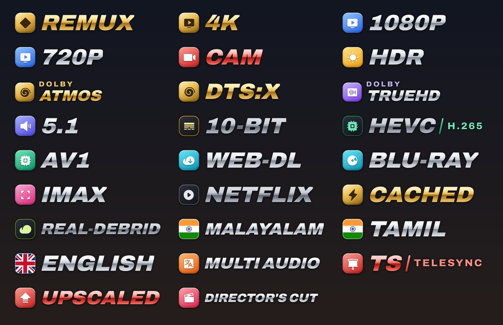

# Nuvio Chrome Badges

261 stream badges. The 31 core quality/audio badges (REMUX, 4K, Dolby Vision, Atmos, DTS…) load their artwork from [Elite-Badges](https://github.com/leonevz/Elite-Badges) by leonevz; the other 230 are in a plate-free **Chrome** style: polished-metal wordmarks, gold metal for top quality, red metal for warnings.



## Install

1. Copy this link:
   ```
   https://raw.githubusercontent.com/freshdewsteam/nuvio-chrome-badges/main/chrome.json
   ```
2. In Nuvio: **Profile → Layout → Streams → Fusion badge URLs**
3. Paste the link, restart Nuvio and open a stream list.

## Colours

| Colour | Meaning |
|---|---|
| Gold | Top quality (REMUX, 4K, Dolby Vision, Atmos, DTS:X, Cached) |
| Red | Warnings (CAM, TS, upscaled, fake HDR) |
| Chrome + coloured tile | Everything else (tile colour = category) |

## Customise

Set `"isEnabled": false` on any badge in `chrome.json` to hide it.

## Credits

Built with the generator from [nuvio-badge-kit](https://github.com/jyotiprakash101/nuvio-badge-kit) by jyotiprakash101 (MIT, see `LICENSE`) — badge list, match patterns and sizing are from that project; the Chrome style (`source/styles_chrome.py`) is new. Icons: Phosphor. Flags: flag-icons. Font: Archivo. Not affiliated with Dolby, DTS, IMAX or any streaming service.
